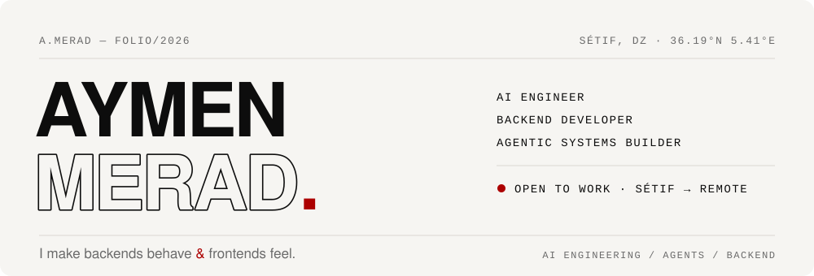

<picture>
  <source media="(prefers-color-scheme: dark)" srcset="assets/header-dark.svg">
  <source media="(prefers-color-scheme: light)" srcset="assets/header-light.svg">
  
</picture>

Graphic designer (5★ on Fiverr) → CS teacher → backend developer at **Ayor.ai**.
I write the boring part of AI products: the API, the database, the guardrails, and the agent that has to do its job without making things up.

---

### Built recently

<table>
<tr>
<td width="50%" valign="top">

**[Ledgerwise AI SDR](https://github.com/aymenm9/Unscale)** · [live](https://ledgerwise-ai-sdr.vercel.app) 
An AI sales rep: finds companies, researches them, writes the first email, answers replies, books calls. Every fact it states points to a stored quote. The hard rules (no prices, opt-out is forever, admits it's a bot) are checked by code first, LLM second. 181 tests. Hosting bill: $0.

FastAPI · LangGraph · Postgres · Next.js

</td>
<td width="50%" valign="top">

**[AI-On](https://github.com/aymenm9/ai-on-backend)** 
A personal finance assistant run by a team of agents: onboarding, budgeting, forecasting, product advice. Send it a photo or a PDF of a receipt and the expense gets logged.

Django REST · multi-agent · Gemini

</td>
</tr>
<tr>
<td width="50%" valign="top">

**[Mustad-il](https://github.com/aymenm9/Mustad-il)** 
A search engine for the Quran and Hadith. TF-IDF gave shaky results on this text, BM25 didn't, so BM25 it is. Hand-written and library versions side by side; they rank almost the same.

Python · FastAPI · BM25 · Gemini

</td>
<td width="50%" valign="top">

**[Tajweed-AI](https://github.com/aymenm9/Tajweed-AI)** 
Backend for a Quran recitation app: AI lessons, quizzes, and recitation correction from audio. Built at Salam Hack, where sleep was optional.

Django REST · Gemini · Docker

</td>
</tr>
</table>

Also: a <a href="https://aymenm9.github.io/portfolio/">portfolio that is a tiny Linux desktop</a> (you navigate it with <code>cd</code> and <code>ls</code>) · <a href="https://github.com/aymenm9/SDG-chat-bots">Gemini bots for the UN SDGs</a> · <a href="https://github.com/aymenm9/MediQueue-AI">MediQueue-AI</a> · <a href="https://github.com/aymenm9/univ_olympiad">a university olympiad platform</a>

---

### Right now

- Building a VS Code extension: select code, type an instruction, review the diff, accept.
- Writing a master's thesis on multi-agent systems.
- Taking a few freelance backend gigs. If you have one, LinkedIn is below.

### What I reach for

**Backend** &nbsp; Python · Django · DRF · FastAPI · SQLAlchemy · Postgres · Docker 
**AI** &nbsp; LangGraph · LangChain · Gemini · Groq · Pydantic for every LLM answer 
**Front** &nbsp; React · Next.js · Svelte, when the backend needs a face 
**For fun** &nbsp; LaTeX. Yes, for fun.

### Off the keyboard

Chess ♟️ · speedcubing 🧩 · wrestling 🤼. Yes, I will challenge you to something.

---

  <a href="https://linkedin.com/in/aymen-merad">LinkedIn</a> ·
  <a href="https://aymenm9.github.io/portfolio/">Portfolio</a> ·
  <a href="https://github.com/setif-developers-group">Setif Developers Group</a>
    
  The board up top is waiting. 1. e4, your move.

