<picture>
  <source media="(prefers-color-scheme: dark)" srcset="assets/header-dark.svg">
  <source media="(prefers-color-scheme: light)" srcset="assets/header-light.svg">
  
</picture>

 

### Hi, I'm Aymen 👋

I build AI systems and backends that do cool stuff, and I keep them clean enough that you can see what they're doing.

♟️ I can beat you in chess. Message me to book a game, or send me an offer. 
🧩 I once solved a Rubik's cube in 7.5 seconds. Once.

Backend Developer at **Ayor.ai** · M.Sc. Data Engineering & Web Technology, Ferhat Abbas University

  
  
  

## Selected work

| # | Project | Stack |
|:--|:--|:--|
| **01** | **[Multi-Agent LLM Architecture Study](https://aymenm9.github.io/portfolio/)** The same task set run on seven architectures, from one monolithic agent to agents generated from scratch. 36 runs scored on coordination, reasoning, cost and emergent behavior. | LangGraph LangSmith FastAPI |
| **02** | **[Multi-Agent Personal Finance Assistant](https://github.com/aymenm9/ai-on-backend)** · 🏆 1st, Finovia Cup 2025 Eight Gemini agents handle budgets, expenses (text, receipt photos, PDFs), forecasts and purchase advice. Budgets rebalance themselves when spending changes. | Django REST Gemini Pydantic |
| **03** | **[Content Delivery Platform](https://aymenm9.github.io/portfolio/)** Built for unstable connections: resumable multipart uploads with per-chunk ETag checks, direct-to-R2 presigned uploads, real-time chat, push notifications. Arabic + English admin dashboard. | Django Channels Redis SvelteKit |
| **04** | **[Event Management Platform](https://github.com/setif-developers-group/Event_management_platform_backend)** Production backend for 1000+ registrations, QR certificates and on-site attendance scanning. Came under attack mid-event; hardened with no downtime. | Django REST Redis Cloudinary |
| **05** | **[AI Tajweed Correction Platform](https://github.com/aymenm9/Tajweed-AI)** Quran recitation backend: AI lessons, quizzes and recitation correction from audio. Built at Salam Hack. | Django REST Gemini Docker |

## Experience

| When | Role | What I did |
|:--|:--|:--|
| Mar 2026 → now | **Backend Developer** · Ayor.ai | Large Django REST codebase shipping to real users. ORM optimization across millions of orders; Google Drive, Sheets, Cloud Run and Claude API integrations. |
| Jan → Feb 2026 | **Backend Developer Intern** · Intellectsoft DZ | Features for a Django medical events system and CRM; multilingual support without breaking existing views. |
| Dec 2024 → Jul 2025 | **Application Development Teacher** · I.E.P Sétif | Python, Java and OOP, SQL databases. |

## Awards

🥇 **Finovia Cup 2025**, multi-agent finance assistant · National School of Management, Koléa 
🥇 **University Olympiads**, AI / Programming · Ferhat Abbas University Sétif 1 
🥉 **University Hackathon** · Ferhat Abbas University Sétif 1

## Stack

My friends say I know these:

**AI engineering** &nbsp; LangGraph · LangChain · LangSmith · multi-agent orchestration · tool calling and structured outputs · RAG · Gemini and Claude APIs · MCP

## Side quests

🤼 Wrestling. Yes, I will challenge you to something. 
🎨 Ex five-star graphic designer on Fiverr. Taught computer science for a year before switching to backend. 
🤖 These days I prompt Claude Code for a living.

---

Prefer pixels? <a href="https://aymenm9.github.io/portfolio/lock">Boot the desktop OS</a> of my portfolio.
